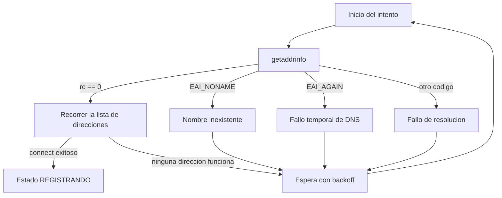

# Despliegue y Resolución de Nombres

El requerimiento 4 del enunciado prohíbe direcciones IP codificadas en el
código y exige resolver nombres de dominio, manejando el fallo de
resolución sin que el servicio termine su ejecución. `overview.md` establece
que la resolución se hace con `getaddrinfo()`; este documento define contra
qué se resuelve, cómo se configura y qué ocurre exactamente cuando falla.

## Por qué es un componente del sistema y no un detalle

La introducción del enunciado señala que un servicio moderno de internet no
depende de un solo protocolo sino de varios servicios cooperando, y menciona
la resolución de nombres como uno de ellos. En este sistema el DNS no es un
accesorio: es lo que permite que el servidor cambie de dirección —al
redesplegarse en otra instancia, o al reiniciarse una instancia con IP
pública dinámica— sin que haya que recompilar ni reconfigurar los nodos.
Esa propiedad es la razón real del requerimiento, y es la respuesta correcta
si en la sustentación se pregunta por qué no basta con poner la IP en un
archivo de configuración.

## Quién resuelve qué

| Entidad | Resuelve | Cuándo |
|---|---|---|
| Nodo | El nombre del servidor central | Antes de cada intento de `connect()` (TCP) y antes del primer `sendto()` (UDP) |
| Cliente administrador | El nombre del servidor central | Antes de cada intento de `connect()` |
| Servidor | Nada hacia afuera | — |

El servidor no resuelve nombres para operar. Solo usa `inet_ntop()` sobre
las direcciones que le entregan `accept()` y `recvfrom()`, y únicamente para
escribirlas de forma legible en el log. **No hace resolución inversa** de las
direcciones de sus clientes: una consulta PTR bloquearía el hilo de conexión
durante el tiempo que tarde la red en responder, y podría fallar por
completo, todo para obtener un nombre que no se necesita para nada. En el
log va la dirección numérica.

## Configuración del nombre

El nombre del servidor se pasa a nodos y clientes por línea de comandos,
nunca por constante compilada:

```
./node   <hostname> <puerto> <nombre-del-nodo> <intervalo-segundos>
./client <hostname> <puerto>
```

En el código no aparece ninguna dirección IP en forma literal. Tampoco
aparece `localhost` como valor por omisión: no hay valor por omisión, y
ejecutar sin argumentos produce un mensaje de uso y terminación inmediata.
Un valor por omisión oculto es una IP codificada con otro nombre.

## Uso de `getaddrinfo()`

```c
struct addrinfo hints = {0};
hints.ai_family   = AF_UNSPEC;    /* IPv4 o IPv6, según lo que exista */
hints.ai_socktype = SOCK_STREAM;  /* SOCK_DGRAM para el socket de telemetría */

struct addrinfo *res = NULL;
int rc = getaddrinfo(hostname, puerto_str, &hints, &res);
```

Cuatro decisiones que conviene poder justificar:

1. **`AF_UNSPEC` y no `AF_INET`.** Deja que la resolución devuelva
   direcciones IPv4 o IPv6 según lo que el nombre tenga publicado, en lugar
   de decidirlo el código. Es lo que hace que el mismo binario funcione en
   una red que solo tenga IPv6.

2. **El puerto se pasa como cadena a `getaddrinfo()`**, no se construye a
   mano una `struct sockaddr_in`. La función llena la estructura completa y
   correcta para la familia que resolvió, incluido el orden de bytes.

3. **Se recorre la lista completa de resultados.** `getaddrinfo()` devuelve
   una lista enlazada, no una sola dirección. Se intenta
   `socket()` + `connect()` sobre cada `ai_next` hasta que uno tenga éxito.
   Quedarse solo con el primer elemento es un error común: si ese primero
   corresponde a una interfaz caída, la conexión falla aunque otra dirección
   del mismo nombre sí funcione.

4. **`freeaddrinfo(res)` en todas las rutas de salida**, incluidas las de
   error. Es memoria reservada por la biblioteca y liberarla es
   responsabilidad de quien llamó.

Para el socket UDP de telemetría se resuelve una vez con
`hints.ai_socktype = SOCK_DGRAM` y se conserva la `sockaddr` resultante para
los `sendto()` sucesivos. No se vuelve a resolver en cada envío: eso
introduciría una consulta DNS en el camino de un mensaje que se envía cada
pocos segundos.

## Manejo del fallo de resolución

Este es el punto que el requerimiento 4 evalúa explícitamente: el fallo debe
manejarse **sin que el servicio termine**.



Reglas:

1. **Nunca se termina el proceso por un fallo de resolución en ejecución.**
   Se registra el error, se espera y se reintenta. Un nombre que no resuelve
   hoy puede resolver en treinta segundos; terminar convierte un problema
   transitorio de red en una caída permanente del nodo.
2. **El error se reporta con `gai_strerror(rc)`**, no con `errno`.
   `getaddrinfo()` no usa `errno` y su código de retorno tiene su propia
   familia de valores.
3. **El *backoff* es exponencial con tope**: 1 s, 2 s, 4 s, 8 s, 16 s, y a
   partir de ahí 30 s fijos. Sin tope, un nodo tardaría horas en
   reconectarse tras una caída larga; sin crecimiento, un nodo consultaría
   el DNS varias veces por segundo indefinidamente. Es el mismo *backoff*
   que usan las transiciones de reintento de `maquinas-de-estado.md` § 1.
4. **Se distingue `EAI_NONAME` de `EAI_AGAIN` en el log.** El primero
   significa que el nombre no existe —casi siempre un error de
   configuración— y el segundo que el DNS no respondió a tiempo, que es
   transitorio. Son diagnósticos distintos y conviene que el archivo de log
   lo refleje.
5. **El único fallo que sí termina el proceso** es que falten argumentos de
   línea de comandos, y ocurre antes de abrir ningún socket.

## Escenarios de despliegue

El sistema debe funcionar en los tres, sin cambios en el código.

### Desarrollo en una sola máquina

Los tres componentes en el mismo equipo. Se define un nombre en
`/etc/hosts`:

```
127.0.0.1   monitoreo.local
```

y se ejecuta `./node monitoreo.local 5000 sensor-lab-01 5`. El código
resuelve un nombre real; que el resolutor sea el archivo de hosts y no un
servidor DNS es indiferente para `getaddrinfo()`. Esto permite probar el
camino de resolución completo sin depender de la red.

### Red local con varias máquinas

Cada equipo apunta al nombre del servidor. Se puede replicar la entrada en
`/etc/hosts` de cada máquina o publicar el nombre en el DNS de la red
local. La ventaja de esta configuración para la sustentación es que permite
demostrar en vivo el requerimiento 1 —al menos dos nodos reportando— con
nodos en máquinas distintas.

### Servidor en AWS (IaaS)

El servidor se ejecuta en una instancia EC2 dentro de la cuenta de AWS
Educate. Puntos a resolver en la Fase 2:

- **El nombre**: la instancia tiene un DNS público asignado
  automáticamente. Ese nombre se puede usar directamente, o registrarse uno
  propio que apunte a la IP elástica. Usar el nombre y no la IP es lo que
  hace que un reinicio de la instancia no rompa a los nodos.
- **Grupo de seguridad**: debe permitir entrada en el puerto elegido **para
  TCP y para UDP por separado**. Son dos reglas, no una. Olvidar la de UDP
  produce el síntoma exacto de que el registro funciona y la telemetría
  nunca llega, con los nodos quedándose permanentemente en `REGISTERED`.
- **Puertos privilegiados**: si el puerto es menor a 1024 se requieren
  privilegios de root para el `bind()`. Se recomienda usar un puerto por
  encima de 1024 y evitar el problema.
- **`bind()` en el servidor**: se enlaza a `INADDR_ANY` (`0.0.0.0`), no a
  una dirección concreta. Esto no contradice el requerimiento 4: `INADDR_ANY`
  no es una dirección de destino codificada, es la instrucción de escuchar
  en todas las interfaces disponibles, que es precisamente lo contrario de
  fijar una IP.
- **NAT y UDP**: si algún nodo está detrás de NAT, el puerto origen de sus
  datagramas UDP puede cambiar entre envíos. El diseño ya lo tolera porque
  el servidor identifica al nodo por el `entity_id` del encabezado y no por
  la dirección de origen (ver `protocol.md`, sección TELEMETRY). La
  dirección de origen se usa solo para el log.

## Comprobación del requerimiento

Para la sustentación, el requerimiento 4 se demuestra en tres pasos:

1. Buscar en el código fuente: no hay ninguna dirección IP en forma
   literal, en ningún componente.
2. Ejecutar un nodo con un nombre que no existe. El nodo registra
   `EAI_NONAME`, reintenta con *backoff* creciente y **no termina**.
3. Con el nodo aún reintentando, agregar el nombre a `/etc/hosts`. El nodo
   se conecta en el siguiente intento sin que haya que reiniciarlo.

El tercer paso es el que realmente demuestra el requerimiento: no basta con
no caerse ante el fallo, hay que recuperarse cuando la resolución vuelve a
funcionar.
