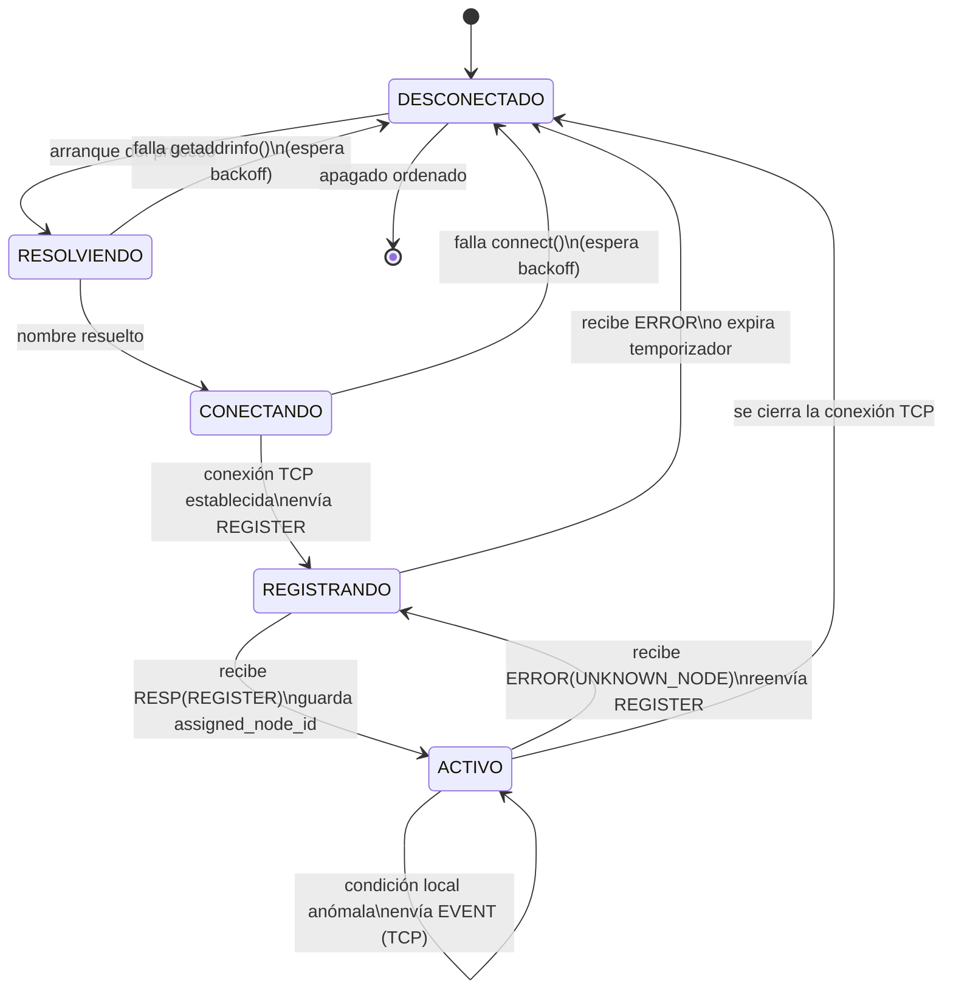
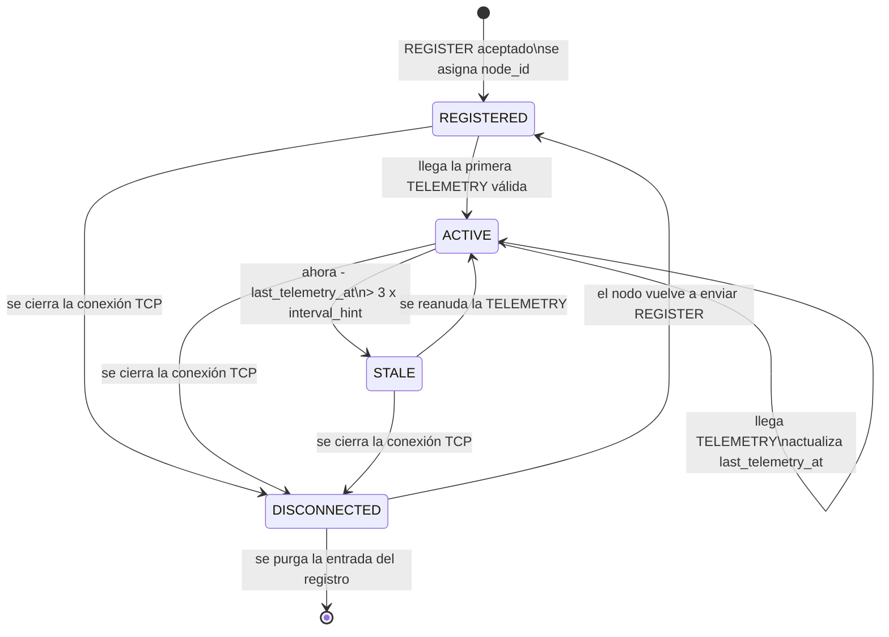
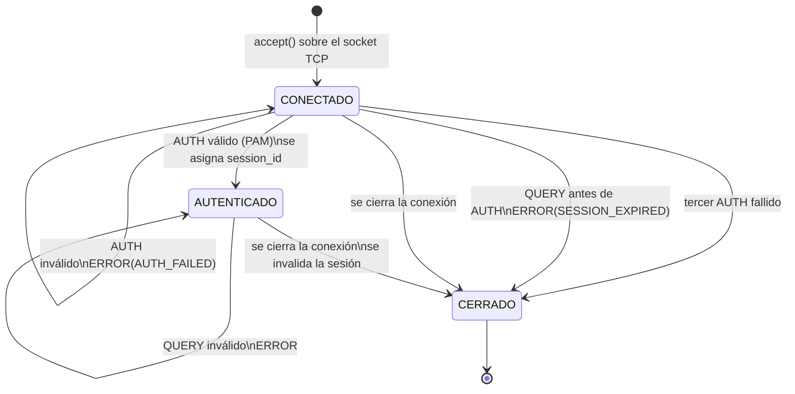
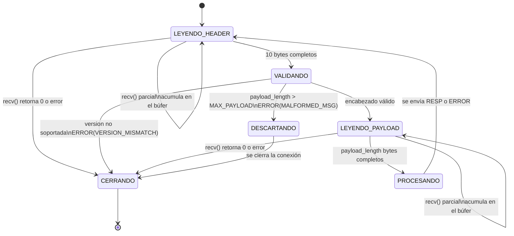

# Máquinas de Estado

Este documento corresponde al punto **"máquinas de estado"** exigido en la
Fase 1, y complementa la sección *Reglas de procedimiento* de
`service-spec.md`. Aquí las transiciones se presentan de forma explícita y
normativa: cada transición indica el **evento** que la dispara, la
**condición** que debe cumplirse y la **acción** que ejecuta la entidad.

Se definen cuatro máquinas de estado independientes:

| # | Máquina | Dónde vive | Se transmite por la red |
|---|---|---|---|
| 1 | Nodo — vista propia | Implementación del nodo | No |
| 2 | Nodo — vista del servidor | Registro del servidor | Sí (campo `state` en `RESP` a `QUERY/STATUS`) |
| 3 | Sesión de cliente administrador | Servidor, asociada a la conexión TCP | No |
| 4 | Recepción de mensaje sobre TCP | Servidor, por cada hilo de conexión | No |

Las máquinas 1 y 2 usan palabras parecidas para cosas distintas. La
distinción es deliberada y se explica en la sección 5.

---

## 1. Nodo — vista propia

Estado interno de la implementación del nodo. Nunca viaja por la red y no
tiene codificación en el protocolo.



### Tabla de transiciones

| Estado origen | Evento | Condición | Acción | Estado destino |
|---|---|---|---|---|
| `DESCONECTADO` | Arranque | — | Invoca `getaddrinfo()` sobre el nombre configurado | `RESOLVIENDO` |
| `RESOLVIENDO` | `getaddrinfo()` falla | — | Registra el error, espera *backoff* | `DESCONECTADO` |
| `RESOLVIENDO` | `getaddrinfo()` retorna | Al menos una dirección | Invoca `connect()` | `CONECTANDO` |
| `CONECTANDO` | `connect()` falla | — | Registra el error, espera *backoff* | `DESCONECTADO` |
| `CONECTANDO` | `connect()` exitoso | — | Envía `REGISTER` con `entity_id = 0` | `REGISTRANDO` |
| `REGISTRANDO` | Recibe `RESP` | `in_response_to = REGISTER` | Guarda `assigned_node_id`, arranca temporizador de telemetría | `ACTIVO` |
| `REGISTRANDO` | Recibe `ERROR` | Cualquiera | Cierra la conexión, espera *backoff* | `DESCONECTADO` |
| `REGISTRANDO` | Expira temporizador de registro | Sin respuesta | Cierra la conexión, espera *backoff* | `DESCONECTADO` |
| `ACTIVO` | Expira temporizador de intervalo | — | Envía `TELEMETRY` por UDP con `entity_id = assigned_node_id` | `ACTIVO` |
| `ACTIVO` | Condición local anómala | — | Envía `EVENT` por la conexión TCP existente | `ACTIVO` |
| `ACTIVO` | Recibe `ERROR(UNKNOWN_NODE)` | — | Descarta `assigned_node_id`, detiene la telemetría, reenvía `REGISTER` | `REGISTRANDO` |
| `ACTIVO` | `recv()` retorna 0 o error | — | Detiene la telemetría, cierra el socket | `DESCONECTADO` |

**Nota sobre el *backoff*:** las transiciones de reintento no deben
reconectar de inmediato en un bucle cerrado. Se define un retardo
incremental con tope —1 s, 2 s, 4 s, 8 s, 16 s, y de ahí en adelante 30 s
fijos— para no saturar al servidor ni al registro de logs cuando el
servidor está caído. El mismo tope se aplica a los fallos de resolución de
nombres; ver `despliegue-y-nombres.md`.

---

## 2. Nodo — vista del servidor

Es el estado que el servidor mantiene en su registro para cada nodo, y el
único que se transmite: viaja en el campo `state` (1 byte) de la `RESP` a
`QUERY/STATUS` y de cada entrada de `QUERY/LIST_NODES`, con la codificación
definida en `protocol.md`:

```
REGISTERED   = 0
ACTIVE       = 1
STALE        = 2
DISCONNECTED = 3
```



### Tabla de transiciones

| Estado origen | Evento | Condición | Acción del servidor | Estado destino |
|---|---|---|---|---|
| *(sin entrada)* | Llega `REGISTER` | `node_name` no está en uso por un nodo conectado | Asigna `node_id`, crea la entrada, responde `RESP(assigned_node_id)` | `REGISTERED` |
| *(sin entrada)* | Llega `EVENT` o `QUERY` sobre un id desconocido | — | Responde `ERROR(UNKNOWN_NODE)` | *(sin entrada)* |
| `REGISTERED` | Llega `TELEMETRY` | `entity_id` corresponde a esta entrada | Actualiza `last_telemetry_at`, inserta en el búfer circular | `ACTIVE` |
| `ACTIVE` | Llega `TELEMETRY` | `entity_id` corresponde a esta entrada | Actualiza `last_telemetry_at`, inserta en el búfer circular | `ACTIVE` |
| `ACTIVE` | Barrido periódico | `ahora - last_telemetry_at > 3 × interval_hint` | Marca la entrada como `STALE`, escribe la transición en el log | `STALE` |
| `STALE` | Llega `TELEMETRY` | `entity_id` corresponde a esta entrada | Actualiza `last_telemetry_at`, inserta en el búfer, escribe la transición en el log | `ACTIVE` |
| `REGISTERED`, `ACTIVE`, `STALE` | `recv()` sobre la conexión TCP retorna 0 o error | — | Marca `DISCONNECTED`, deja de aceptar `TELEMETRY` con ese `node_id` | `DISCONNECTED` |
| `DISCONNECTED` | Llega `REGISTER` con el mismo `node_name` | — | Asigna un `node_id` **nuevo**, reinicia la entrada | `REGISTERED` |

### Reglas invariantes

1. `DISCONNECTED` es **absorbente respecto a la telemetría**: mientras la
   entrada esté en ese estado, toda `TELEMETRY` que llegue con ese
   `node_id` se descarta y se registra en el log. Esto evita que un proceso
   distinto suplante a un nodo que ya no está usando un id que quedó libre.
2. Por la misma razón, un nodo que vuelve tras un `DISCONNECTED` recibe un
   `node_id` **nuevo**, nunca el anterior. Reutilizar el id haría
   indistinguibles los datos de antes y después de la desconexión.
3. No existe un valor de estado `UNKNOWN`. Un `node_id` que el servidor
   nunca ha visto simplemente no tiene entrada en el registro, y esa
   situación se comunica con `ERROR(UNKNOWN_NODE)`, no con un estado.
4. La transición a `STALE` la produce el **barrido periódico**, no una
   consulta. Un nodo cuya telemetría se detuvo debe reportarse como `STALE`
   aunque nadie lo consulte.
5. La única fuente de tiempo para `last_telemetry_at` es el reloj del
   servidor en el instante en que retorna `recvfrom()`. El campo
   `node_timestamp` del mensaje nunca se usa para decidir transiciones.

### Sobre el multiplicador 3×

El umbral de `STALE` es `3 × telemetry_interval_hint`. Se elige 3 y no 2
porque con UDP la pérdida de un solo datagrama es esperable y no debería
degradar el estado del nodo; 3 intervalos toleran dos pérdidas
consecutivas antes de declarar la telemetría interrumpida. No se elige un
valor mayor porque alargaría demasiado la detección de una falla real. Si
`interval_hint` llega en `0`, el servidor sustituye el valor por un
predeterminado de 5 segundos antes de calcular el umbral, para no producir
un umbral nulo que marcaría el nodo como `STALE` de inmediato.

---

## 3. Sesión de cliente administrador

Vive en el servidor, asociada a una conexión TCP concreta. No sobrevive al
cierre de esa conexión.



### Tabla de transiciones

| Estado origen | Evento | Condición | Acción del servidor | Estado destino |
|---|---|---|---|---|
| `CONECTADO` | Llega `AUTH` | `pam_authenticate()` exitoso | Genera `session_id`, lo asocia a la conexión, responde `RESP(session_id)` | `AUTENTICADO` |
| `CONECTADO` | Llega `AUTH` | `pam_authenticate()` falla, 1.er o 2.º intento | Responde `ERROR(AUTH_FAILED)`, registra el intento en el log | `CONECTADO` |
| `CONECTADO` | Llega `AUTH` | `pam_authenticate()` falla, 3.er intento | Responde `ERROR(AUTH_FAILED)`, lo registra y cierra el descriptor | `CERRADO` |
| `CONECTADO` | Llega `QUERY` | Sin `AUTH` previo | Responde `ERROR(SESSION_EXPIRED)` y cierra la conexión | `CERRADO` |
| `AUTENTICADO` | Llega `QUERY` | `entity_id` coincide con el `session_id` vivo y `query_type` es válido | Responde `RESP` con el cuerpo correspondiente | `AUTENTICADO` |
| `AUTENTICADO` | Llega `QUERY` | `entity_id` no coincide con el `session_id` | Responde `ERROR(SESSION_EXPIRED)` | `AUTENTICADO` |
| `AUTENTICADO` | Llega `QUERY` | `query_type` no reconocido | Responde `ERROR(UNSUPPORTED_QUERY)` | `AUTENTICADO` |
| `AUTENTICADO` | Llega `QUERY/STATUS` o `QUERY/HISTORY` | `target_node_id` sin entrada en el registro | Responde `ERROR(UNKNOWN_NODE)` | `AUTENTICADO` |
| Cualquiera | `recv()` retorna 0 o error | — | Libera el `session_id`, cierra el descriptor, termina el hilo | `CERRADO` |

**Límite de intentos de autenticación.** `CONECTADO → CONECTADO` ante un
`AUTH` fallido permite reintentar sobre la misma conexión, que es lo
razonable ante un error de tecleo. Para que eso no habilite un ataque de
fuerza bruta indefinido, el servidor cuenta los intentos fallidos por
conexión y cierra el descriptor tras el tercero, registrando el hecho en
el log. El contador es por conexión, no por usuario: no existe estado
persistente entre conexiones.

---

## 4. Recepción de mensaje sobre TCP

Esta máquina se ejecuta dentro de cada hilo de conexión y describe cómo se
lee un mensaje del flujo TCP. Existe porque TCP es un flujo de bytes sin
fronteras de mensaje: un `recv()` puede devolver medio mensaje, un mensaje
completo, o dos mensajes pegados. La lectura debe estar dirigida por el
campo `payload_length` del encabezado, nunca por lo que un `recv()` haya
devuelto.



### Reglas de procedimiento

1. **El encabezado son 10 bytes**: `version` (1) + `msg_type` (1) +
   `entity_id` (4) + `payload_length` (4). La lectura del encabezado debe
   repetir `recv()` en bucle hasta acumular exactamente 10 bytes. El
   desglose de campos está en `protocol.md` § Encabezado fijo.
2. **`payload_length` se valida antes de reservar memoria.** El máximo es
   `MAX_PAYLOAD = 4096` bytes (`protocol.md` § Límites de tamaño). Un valor
   mayor produce `ERROR(MALFORMED_MSG)` y cierre de la conexión, sin
   intentar la reserva. Sin esta validación, un cliente malicioso podría
   declarar un payload de 4 GB y agotar la memoria del servidor.
3. **La lectura del payload también es en bucle.** Se leen exactamente
   `payload_length` bytes antes de intentar interpretar el mensaje.
4. **Todo mensaje completo produce exactamente una respuesta** (`RESP` o
   `ERROR`) sobre la misma conexión, salvo `TELEMETRY`, que no viaja por
   TCP. Esta garantía es la que le permite a un cliente bloquearse en
   `recv()` después de enviar una consulta.
5. **Después de responder se vuelve a `LEYENDO_HEADER`** sobre la misma
   conexión. Los bytes sobrantes que ya estén en el búfer del hilo se
   conservan y se consideran el inicio del siguiente mensaje; no se
   descartan.

### Contraparte en UDP

`TELEMETRY` no usa esta máquina. Un datagrama UDP conserva sus fronteras,
por lo que un solo `recvfrom()` entrega el mensaje completo o nada. El
procedimiento es:

1. `recvfrom()` sobre el socket `SOCK_DGRAM`.
2. Si los bytes recibidos son menos de 10, el datagrama se descarta y se
   registra en el log. No hay respuesta posible.
3. Se valida `version` y que `payload_length` coincida con el tamaño real
   del payload de `TELEMETRY` (13 bytes). Si no coincide, se descarta y se
   registra.
4. Si el `entity_id` no corresponde a una entrada en estado `REGISTERED`,
   `ACTIVE` o `STALE`, el datagrama se descarta y se registra.
5. En cualquier otro caso se actualiza el registro. **Nunca se envía
   respuesta**, ni de éxito ni de error.

---

## 5. Por qué hay dos máquinas para el nodo

Las máquinas 1 y 2 describen al mismo nodo desde dos puntos de vista que no
se pueden unificar, porque cada extremo solo observa una parte de lo que
ocurre:

- El nodo sabe si está intentando resolver un nombre o reconectarse, pero
  **no sabe si su telemetría está llegando**, porque UDP no confirma nada.
  Por eso su máquina no tiene `STALE`.
- El servidor sabe si la telemetría dejó de llegar, pero **no sabe por
  qué**: no distingue un nodo apagado de una red congestionada. Por eso su
  máquina no tiene `RESOLVIENDO` ni `CONECTANDO`.

Un nodo puede estar en `ACTIVO` (su vista) mientras el servidor lo tiene en
`STALE` (vista del servidor) al mismo tiempo: la conexión TCP sigue viva,
el nodo sigue enviando datagramas, pero esos datagramas se están perdiendo
en la red. Esa divergencia no es un error del diseño, es la consecuencia
directa de haber elegido UDP para la telemetría, y el estado `STALE` existe
precisamente para hacerla visible al administrador.
