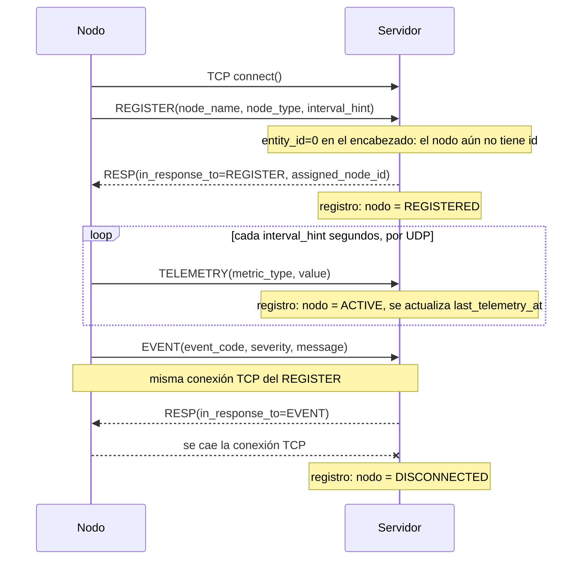
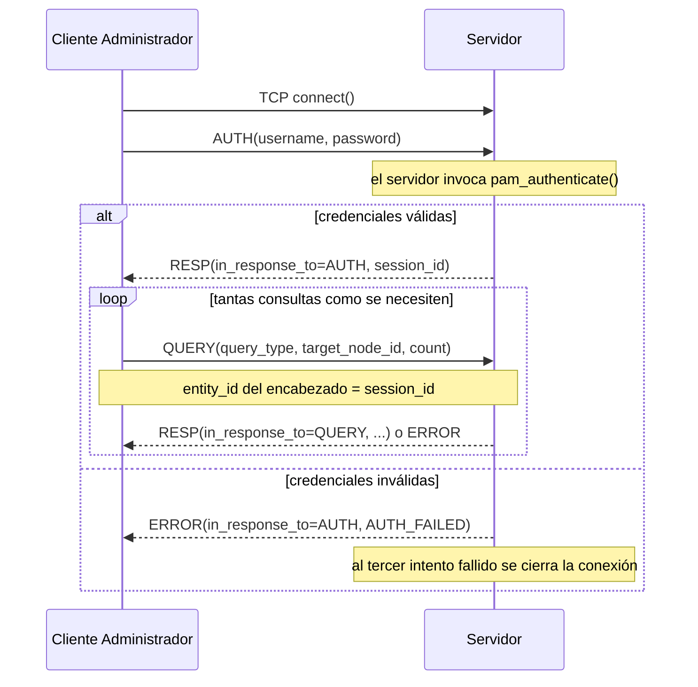
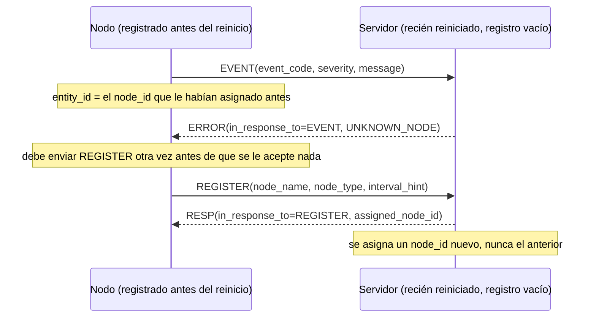
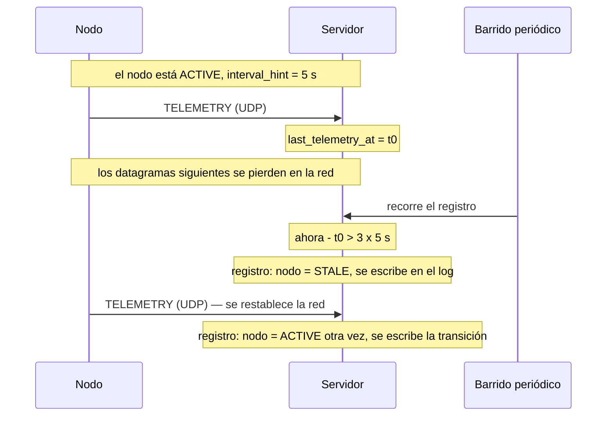

# Diagramas de Secuencia

Este documento es el punto (e) de la estructura estilo RFC 793 descrita en
`docs/README.md`: ejemplos concretos del protocolo en movimiento, sobre las
definiciones abstractas de `protocol.md` y `service-spec.md`. GitHub
renderiza estos diagramas Mermaid de forma nativa al ver el archivo en el
repositorio.

## 1. Ciclo de vida del nodo — camino feliz

Un REGISTER por TCP, luego TELEMETRY repetida por UDP, con algún EVENT
intercalado cuando ocurre algo relevante, todo mientras la misma conexión
TCP del REGISTER permanece abierta.

## 2. Cliente administrador — autenticarse y luego consultar

El AUTH debe tener éxito antes de que se acepte cualquier QUERY; el
`session_id` resultante viaja en el encabezado (`entity_id`) de cada QUERY
de esa conexión.

## 3. Camino de error — el nodo reporta después de que el servidor lo olvidó

Como el historial vive solo en memoria (ver `service-spec.md`), un
reinicio del servidor borra el registro. Un nodo que se había registrado
antes del reinicio todavía no lo sabe, y se entera mediante un ERROR en
lugar de un fallo silencioso.

## 4. Transición a `STALE` — la telemetría se detiene sin que se caiga la conexión

Este es el escenario que justifica la existencia del estado `STALE` y, con
él, la elección de UDP para la telemetría. La conexión TCP sigue viva, así
que el servidor no puede declarar al nodo `DISCONNECTED`, pero los
datagramas dejaron de llegar.

Obsérvese que el nodo nunca se enteró de nada: desde su punto de vista
siguió en `ACTIVO` todo el tiempo, enviando datagramas. Esa divergencia
entre las dos vistas está explicada en `maquinas-de-estado.md` § 5.
