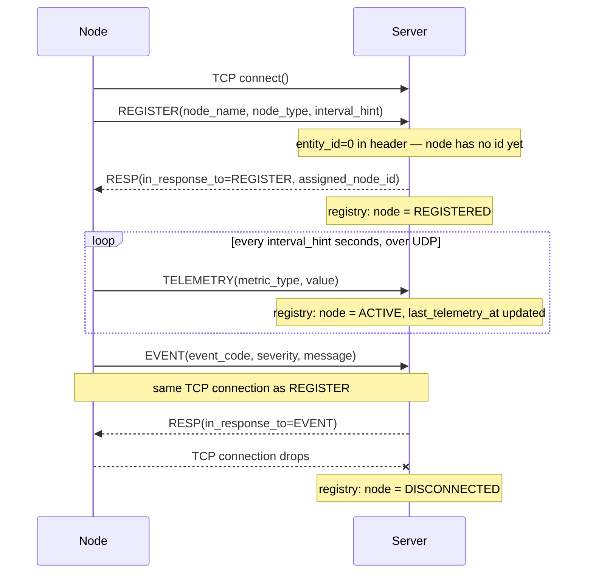
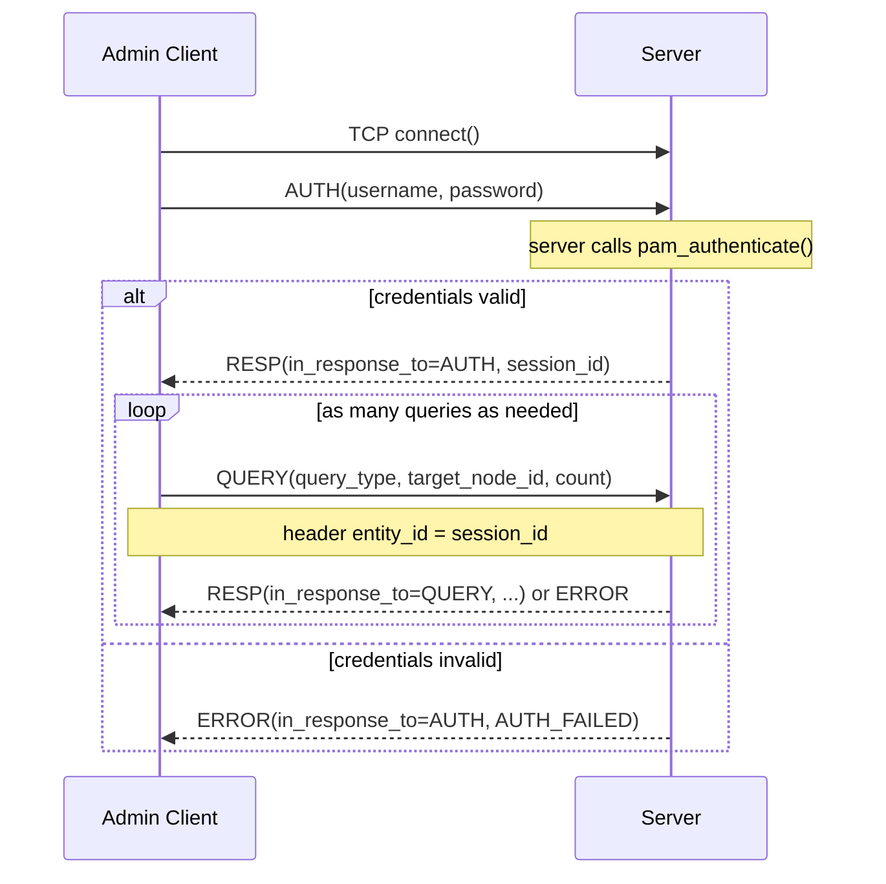
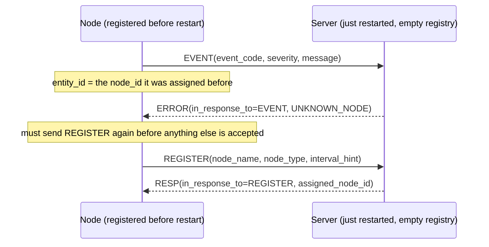

# Sequence Diagrams

This is item (e) of the RFC-793-style structure from `docs/README.md` —
concrete examples of the protocol in motion, on top of the abstract
definitions in `protocol.md` and `service-spec.md`. GitHub renders these
Mermaid diagrams natively when viewing this file in the repo.

## 1. Node lifecycle — happy path

REGISTER once over TCP, then TELEMETRY repeatedly over UDP, with an EVENT
squeezed in whenever something noteworthy happens — all while the same TCP
connection from REGISTER stays open.

## 2. Admin client — authenticate, then query

AUTH must succeed before any QUERY is accepted; the resulting `session_id`
travels in the header (`entity_id`) of every QUERY on that connection.

## 3. Error path — node reports after the server has forgotten it

Because history is in-memory only (see `service-spec.md`), a server
restart wipes the registry. A node that registered before the restart
doesn't know that yet, and finds out via an ERROR instead of a silent
failure.

